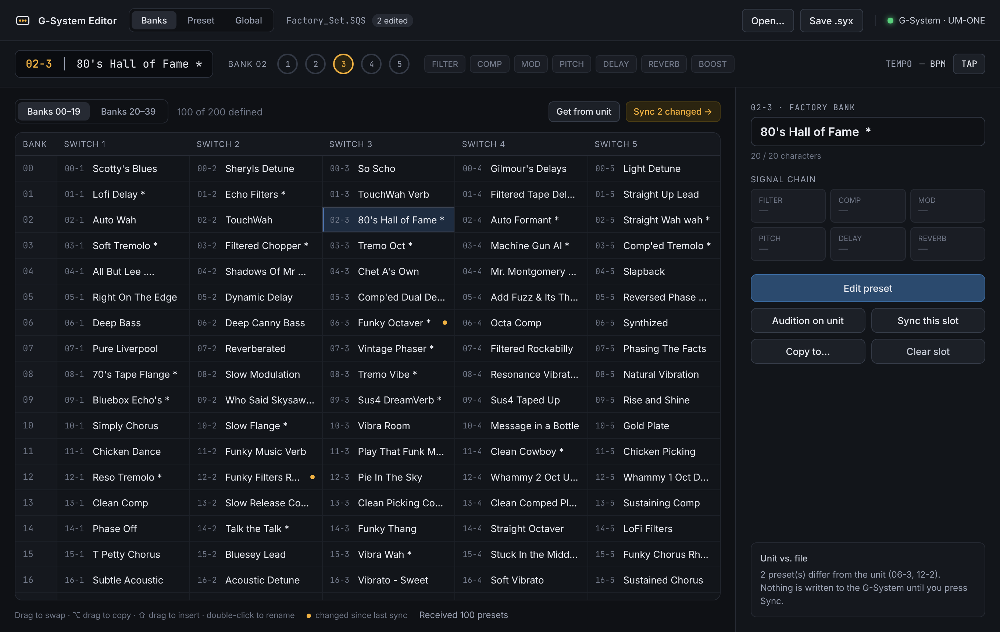
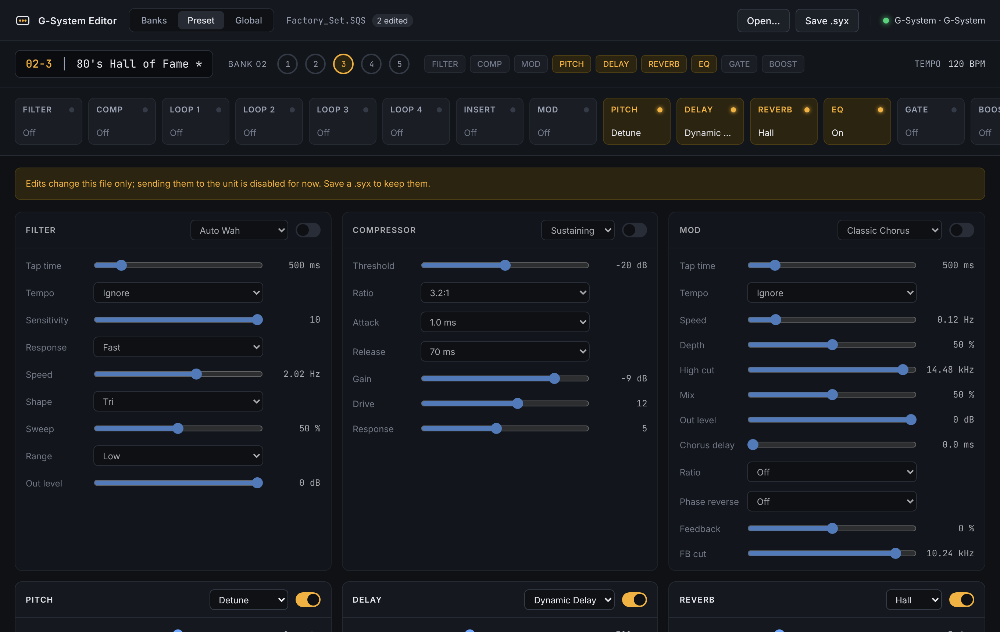
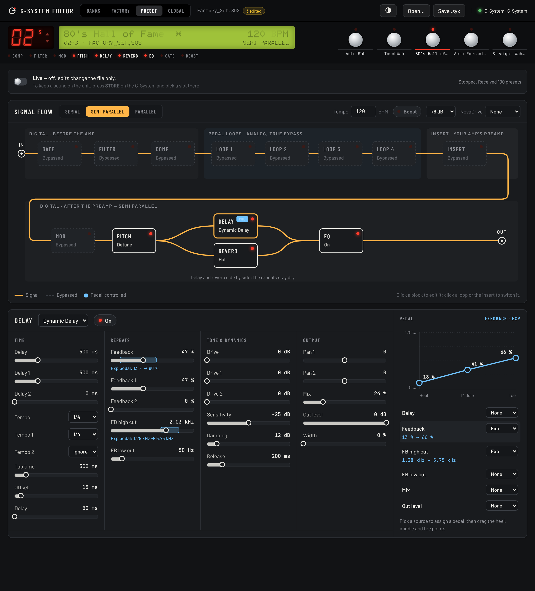
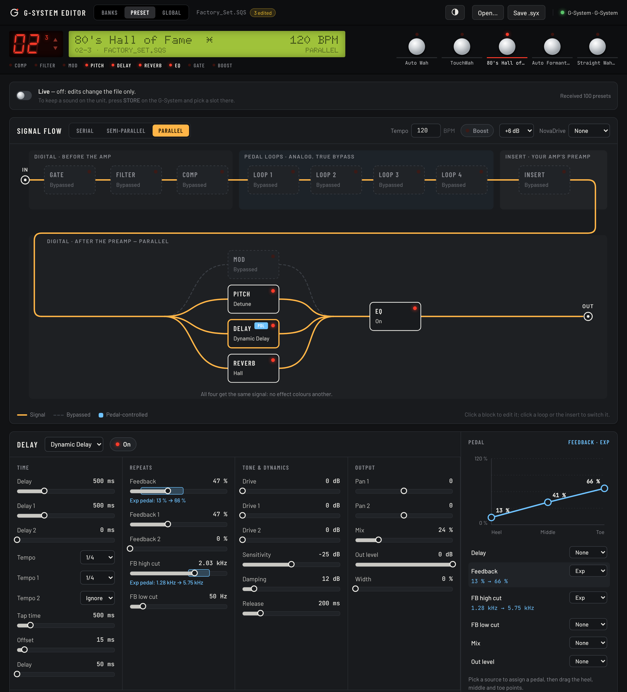
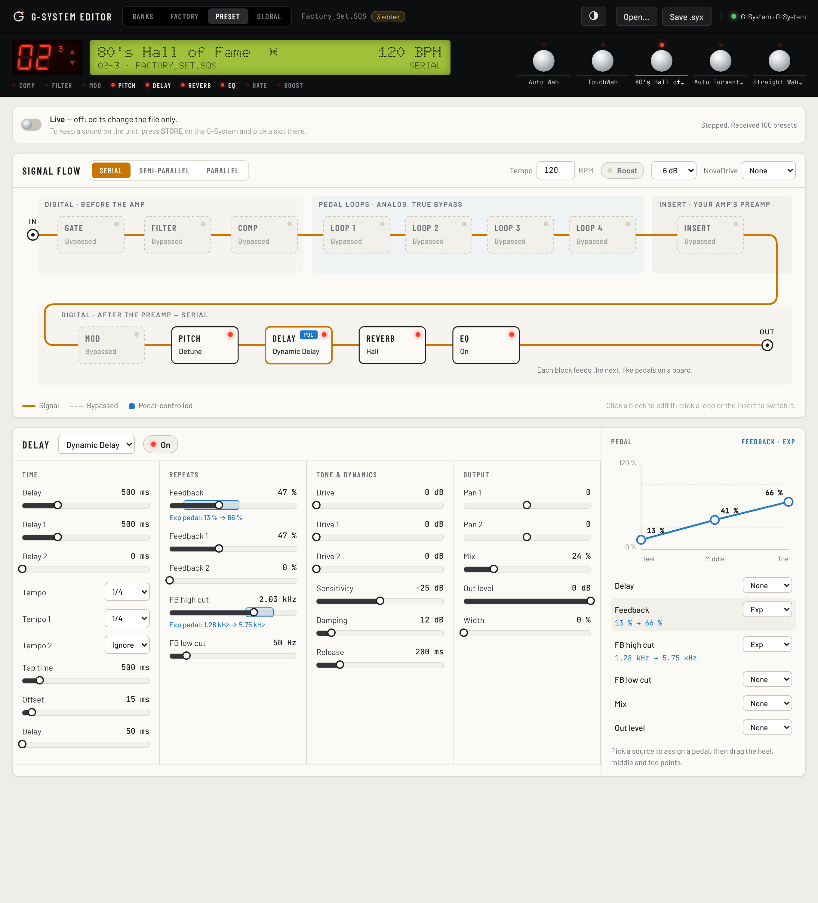
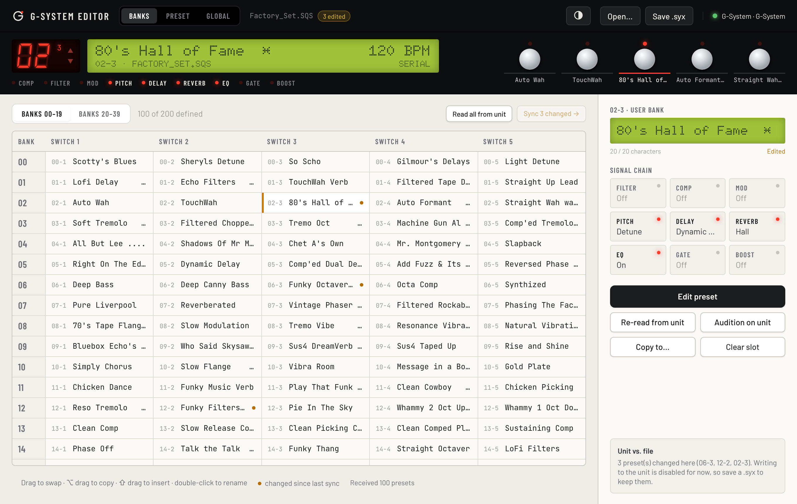
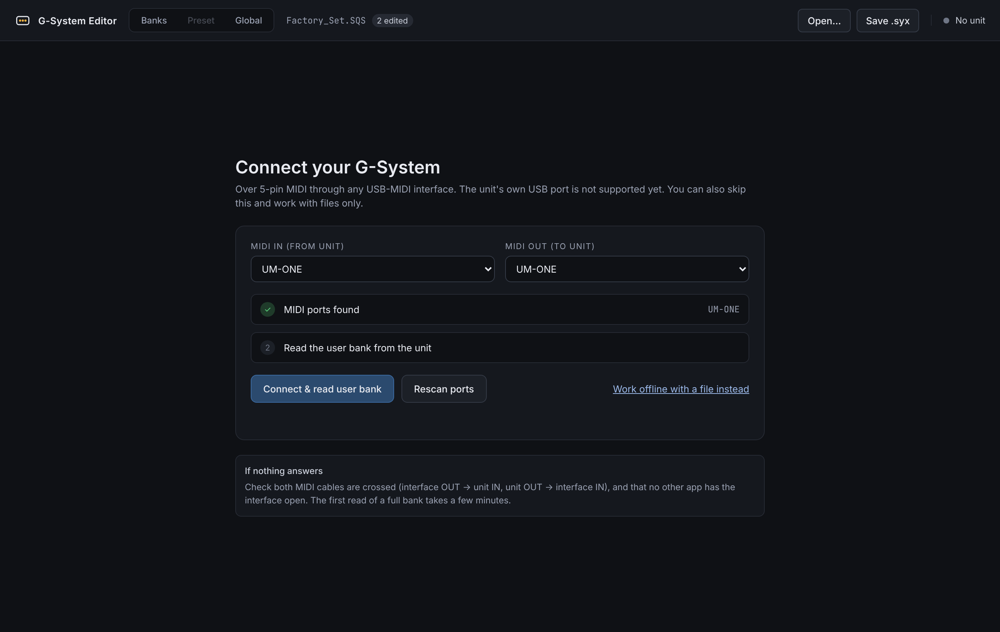
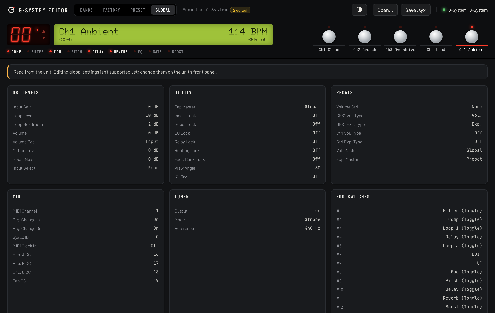

# G-System Editor

A modern, cross-platform (macOS / Linux / Windows) librarian and editor for the
TC Electronic G-System, replacing the 2008 Vyzor-based editor that no longer
runs on current operating systems.

> **Looking for a working editor today?** An independent project,
> [G-System Editor by David Avalanches](https://davidavalanches.github.io/gsystem-editor/)
> ([source](https://github.com/davidavalanches/gsystem-editor), GPL-3.0), has been
> tested on real hardware and runs on macOS, Linux and Android. This repo started
> separately; its parameter tables, levels and tempo code are now ported to Rust
> from that project (credited in each file and in `PROTOCOL.md`).

Status: **reading works; presets reach the unit through its own Store button.** Banks and presets
load from `.SQS`/`.syx` files and from the unit over MIDI. The unit's own USB
port shows up as a MIDI device, so no interface is needed. Every effect block,
type and parameter is decoded and editable, along with routing, loops, insert,
boost, tempo, modifier (pedal/encoder) assignments and the NovaDrive preset.
Global settings and footswitch assignments are read from the unit.

To hear a preset, *Audition* loads it into the unit's edit buffer, and *Live*
mode sends every edit there as you make it. To keep it, press **STORE** on the
G-System, which uses the firmware's own store. Direct preset store (Vyzor's
Sync) stays off in the app because it has frozen a unit; see
[`docs/writing-to-the-unit.md`](docs/writing-to-the-unit.md) for what's known
and the steps to try next.

```
crates/gsystem-protocol   SysEx codec, preset/bank model, .SQS/.Prs/.syx parsers (no I/O deps)
cli/                      `gsys` command-line tool (librarian + MIDI via midir)
app/                      Tauri 2 desktop app (Vite + TypeScript UI, Rust backend)
testdata/                 Factory_Set.SQS (100 factory presets), Twilight.Prs
tools/                    gsys_preset_decode.py — the Python prototype of the codec
```

## Screenshots

The header and front panel look like the unit: the red 7-segment bank display,
the dot-matrix LCD, the five preset footswitches (click to select, ▲▼ to
change bank) and the effect LEDs. Everything below is built around the
signal path. Light and dark follow your OS; the header button switches them.

**Banks**: the 200-slot user bank laid out like the footswitches, with an
inspector for the selected preset. Amber dots mark slots that differ from the unit.



**Preset**: the signal flow as the unit actually wires it. The digital
blocks before the amp come first, then the four analog loops, then the insert
(usually your amp's preamp), then the digital blocks after it. The routing
redraws the cables: *Serial* in a line, *Semi-parallel* with Delay and Reverb
side by side, and *Parallel* with Mod, Pitch, Delay and Reverb all fed the same
signal. Click a block to edit it; click a loop or the insert to switch it.

The block editor groups parameters by what they do (time, repeats, tone &
dynamics, output; EQ by band). Click or drag a slider, or use the arrow keys
(Shift for bigger steps). A parameter on a pedal shows its range right on
the slider. The **Pedal** panel draws the heel, middle and toe values as a
curve you can drag. In Live mode, every change goes to the unit's edit buffer
as you make it.



<table>
<tr>
<td width="50%"><b>Semi-parallel</b><br></td>
<td width="50%"><b>Parallel</b><br></td>
</tr>
<tr>
<td width="50%"><b>Light</b><br></td>
<td width="50%"><b>Banks, light</b><br></td>
</tr>
</table>

Where Gate and EQ sit in the chain isn't shown in TC's block diagram; the
editor draws Gate first and EQ last. Corrections welcome.

<table>
<tr>
<td width="50%"><b>Connect</b> — replaces the old AutoSense dialogs<br></td>
<td width="50%"><b>Global</b> — reads levels, locks, pedals, MIDI, tuner and footswitches from the unit<br></td>
</tr>
</table>

Screenshots are generated from the real frontend with the factory set loaded;
see `tools/screenshots`.

## Installing

Download from the [Releases](https://github.com/jeffreygnatek/g-system/releases) page:

- **macOS** — `.dmg` (Apple Silicon or Intel). The build is not signed: the
  first time, right-click the app and choose **Open**, or run
  `xattr -dr com.apple.quarantine "/Applications/G-System Editor.app"`.
- **Linux** — `.deb` or `.AppImage`.
- **Windows** — `.msi`.
- `gsys-*` archives are the command-line tool on its own.

Releases are built by GitHub Actions when a `v*` tag is pushed
(`git tag v0.1.0 && git push origin v0.1.0`) and appear as a draft to
publish by hand. Set the `APPLE_*` secrets named in
`.github/workflows/release.yml` to get signed and notarized macOS builds.

## Build

Requirements: Rust (stable), Node 20+. On Linux also ALSA headers
(`libasound2-dev`) for MIDI and the usual Tauri deps (`libwebkit2gtk-4.1-dev`,
`libgtk-3-dev`, `librsvg2-dev`, `libayatana-appindicator3-dev`).

```sh
cargo test                                   # protocol tests against the factory set
cargo run -p gsys -- list testdata/Factory_Set.SQS

cd app && npm install
npm run tauri dev                            # desktop app (dev)
npm run tauri build                          # .app / .deb / .msi
```

## CLI

```
gsys list <file>                 slots and names from .SQS / .syx / .Prs
gsys export <in.SQS> <out.syx>   plain SysEx dump of all occupied slots
gsys show <file> <slot>          decode one preset: every block, type and parameter
gsys json <file>                 raw fields + decoded view per preset
gsys scripts <file.Prs>          SysEx the old editor sent/expected for that preset
gsys rename <in.syx> <slot> "<name>" <out.syx>

gsys ports
gsys identify <port>             firmware version, via Device Inquiry
gsys globals <port>              global settings and footswitch assignments (read-only)
gsys monitor <port>
gsys request <port> <slot>
gsys backup  <port> <out.syx> [from] [to]
gsys audition <port> <file> <slot>   load into the unit's edit buffer (press STORE on the unit to keep)
gsys raw     <port> "F0 7E 7F 06 01 F7"
gsys store   <port> <file.syx> <file-slot> <unit-slot> --sysex-id <n> --i-accept-the-risk
gsys mcp --bank <file.syx> [--port <port>] [--read-only]   MCP server for AI agents (below)
```

Port names match by substring (`gsys ports` lists them; usually "G-System").
Slots are 0-based user slots: 0 = 00-1 … 199 = 39-5. `store` can freeze the
unit, so back up with `backup` first.

## Design presets with an AI agent (MCP)

`gsys mcp` is a [Model Context Protocol](https://modelcontextprotocol.io)
server, so an agent such as Claude Desktop or Claude Code can design and edit
presets from a musical brief ("Gilmour lead: comp, delay ~440 ms, hall"). It
works on a **working bank file**, and the agent gets a catalog of every block,
effect type and parameter, so it writes values like `"350 ms"`, `"2.5 kHz"`
or `"1/8D"` instead of guessing raw numbers.

Tools: `get_catalog`, `list_presets`, `get_preset`, `create_preset`,
`update_preset`, `copy_preset`, `rename_preset`, `clear_slot`,
`validate_preset`, `find_empty_slot`, and `audition` when a MIDI port is
given. There is also a `design_preset` prompt with guidance for the agent.

**Safety model.** The agent never stores anything on the unit. Changes go to
the bank file (written atomically after each change; the first change of a
session keeps the previous file as `<bank>.bak`). `audition` loads a preset
into the G-System's **edit buffer** only, like turning knobs; to keep the
sound, press **STORE** on the unit. There is no store tool, because the
editor store sequence has frozen units (see `PROTOCOL.md`).

- `--bank <file>`: a `.syx` (created empty if missing). A `.SQS`, `.Prs` or
  `.Ebf` is loaded and changes are saved to `<same name>.syx`.
- `--port <name>`: the unit's MIDI port (as in `gsys ports`); enables `audition`.
- `--read-only`: hide the tools that change the bank.

Install `gsys` with `cargo install --path cli` (or use a release archive).
For Claude Code:

```sh
claude mcp add gsystem -- gsys mcp --bank ~/G-System/agent.syx --port "G-System"
```

For Claude Desktop, add to `claude_desktop_config.json` (absolute paths; `~`
is not expanded there):

```json
{
  "mcpServers": {
    "gsys": {
      "command": "/Users/you/.cargo/bin/gsys",
      "args": ["mcp", "--bank", "/Users/you/G-System/agent.syx", "--port", "G-System"]
    }
  }
}
```

During development, run it from the repo with
`cargo run -q -p gsys -- mcp --bank /tmp/agent.syx`.

## First session with the unit

1. Connect the G-System's USB port to the computer (or a USB-MIDI interface to its 5-pin jacks).
2. `gsys ports`, then `gsys identify G-System`.
3. `gsys backup G-System my-unit.syx` reads all 200 user slots (about 2½ minutes; empty slots are skipped).
4. Open `my-unit.syx` in the app, or use the app's Connect screen to do the same thing.
5. Try `gsys audition G-System my-unit.syx 0`, or the app's *Audition* / *Live*, and
   keep sounds with the unit's STORE button.
6. When you're ready to test direct store, follow
   [`docs/writing-to-the-unit.md`](docs/writing-to-the-unit.md) step 2.

## License

Copyright (C) 2026 Jeff Gnatek

This program is free software: you can redistribute it and/or modify it under
the terms of the GNU General Public License as published by the Free Software
Foundation, either version 3 of the License, or (at your option) any later
version. See [`LICENSE`](LICENSE).

In short: you may use, modify and share it, but anything you distribute that is
built from it must also be released under the GPL with its source code.

Not affiliated with TC Electronic / Music Tribe.
